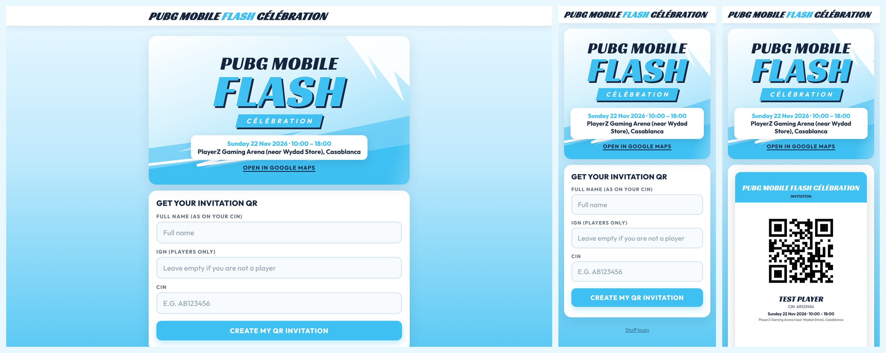

# PUBG MOBILE FLASH CÉLÉBRATION – QR invitations and check-in

**Live site:** https://xrobotexe.github.io/PUBG-FLASH-event/

One-page web app for the PUBG MOBILE FLASH CÉLÉBRATION community event at PlayerZ Gaming Arena, Casablanca. Guests make their own QR invitation on their phone, and staff scan it at the door.



## What it does

**For guests and players (public page)**
- Enter full name, IGN (players only) and CIN, then get a QR invitation card to download or share.
- After the QR is shown, the page opens the event's Instagram post.

**For staff (`#staff`, login required)**
- **Scan**: live camera or photo scan of a guest QR, or check by CIN or name. Shows a clear green / red / orange result and marks the guest as entered.
- **Guests**: player and guest lists, add one at a time or paste a list from Excel or Google Sheets, filters by status and team, and a zip download of every player's pass.
- **QRs**: everyone who made an invitation on the public page.
- **Staff** (organizer only): create and remove staff accounts.

## How it is built

- A single `index.html` file (HTML, CSS and plain JavaScript), hosted on GitHub Pages.
- [Supabase](https://supabase.com) for staff login and the guest database (tables `staff`, `guests`, `registrations`, and the `claim_first_admin` function).
- Libraries loaded from CDNs: `supabase-js`, `qrcode-generator`, `jsQR` and `JSZip`.

## Change the event

Edit the **SETTINGS** block at the top of the `<script>` in `index.html`:

| Setting | What it is |
| --- | --- |
| `SUPABASE_URL`, `SUPABASE_ANON_KEY` | Your Supabase project (Project Settings > API). The anon key is public by design; the data is protected by Supabase row level security. |
| `INSTAGRAM_URL` | Post opened after a guest makes their QR |
| `EVENT` | Name, date, place and Google Maps link |
| `EVENT_OPEN` | On/off switch. `false` closes the event: the public page shows "See you at the next event" and staff scanning is off. Lists and data are kept. Set to `true` for the next event. |
| `CLOSED_TITLE`, `CLOSED_TEXT` | Message guests see while the event is closed |

If the event name, date or place changes, also update the `description`, `og:` and `twitter:` tags in `<head>` and the social preview image `assets/og-image.jpg`.

**First setup:** open `/#setup` once to create the organizer account. It only works while there is no staff yet. In Supabase, turn off "Confirm email" (Authentication > Sign In / Providers > Email).

## Files

```
index.html            the whole app
assets/og-image.jpg   link preview image (WhatsApp, Instagram, Facebook, X)
docs/screenshot.jpg   screenshot used in this README
```

## Deploy

Push to `main`. GitHub Pages republishes the site in about a minute.
